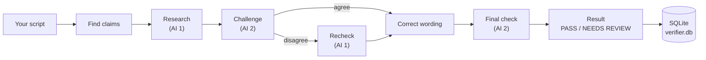

# Script Verifier

**Check the technical facts in a script before you publish it: every claim is researched, challenged by a second AI, fixed if wrong, and backed by sources.**


## What is Script Verifier?

If you write a script for a video, talk or blog post, one wrong technical fact can ruin it, and checking every fact by hand takes a long time.

Script Verifier does the checking for you. Paste your script and it will:

1. Pull out each technical claim.
2. Ask one AI to research it and find sources.
3. Ask a second AI to challenge that answer.
4. Fix the wording of claims that turn out to be wrong.
5. Give you the final script with a **PASS** or **NEEDS REVIEW** result.

| Step | Default AI | What it does |
|---|---|---|
| Research | DeepSeek | Finds sources and says if the claim is true |
| Challenge | Claude | Looks for mistakes in the research |
| Recheck | DeepSeek | Looks again if the two disagree |
| Final check | Claude | Checks the corrected script |

You can change which AI does which step in `config.json`.

## Features

- **Claim by claim:** each fact gets its own status, sources and correction
- **Two AIs check each other:** one researches, the other challenges
- **Better sources first:** RFCs and standards, then official docs, then papers, then other sites
- **Live progress:** watch each step in the Progress tab
- **Clear result:** the final script, a list of changes, and PASS / NEEDS REVIEW
- **Everything saved:** scripts, claims, sources and corrections go into a local SQLite database
- **Export:** copy the result as Markdown

## How it works



The app has three parts:

| Part | Made with | Job |
|---|---|---|
| Window | React + Tauri | Input, Progress, Claims and Result tabs |
| Orchestrator | Rust | Runs the steps, checks results, saves to SQLite |
| Browser worker | Node + Playwright | Opens the AI chat pages and sends prompts |

## Quick start

**Requirements:** Linux, Node.js 18 or newer, Rust 1.77 or newer, a C compiler, and the Tauri system libraries (WebKitGTK).

On Arch-based systems:

```sh
sudo pacman -S --needed base-devel nodejs npm rust webkit2gtk-4.1
```

**1. Clone**

```sh
git clone https://github.com/Muzasio/script-verifier.git
cd script-verifier
```

**2. Build the browser worker**

```sh
cd browser-worker
npm install
npx playwright install chromium
npm run build
cd ..
```

**3. Install the window and run it** (from the repo root)

```sh
npm install
npm run start
```

`npm run start` is `tauri dev` with settings that avoid WebKit display problems on Wayland. You can use `npm run tauri dev` instead if it works on your system.

**4. Log in once**

The first time you run it, a Chromium window opens. Log in to each AI site there. The login is kept in `browser-worker/profile/`, so you only need to do this once.

**5. Try it**

Paste a short script with one true fact and one wrong fact, then click **Start Verification**.

## Settings

All settings are in `config.json` in the repo root.

| Setting | Default | What it does |
|---|---|---|
| `providers` | `gemini`, `claude`, `deepseek` | The AI sites the worker can open |
| `roles.research` | `deepseek` | AI that researches each claim |
| `roles.challenge` | `claude` | AI that challenges the research |
| `roles.recheck` | `deepseek` | AI that looks again when they disagree |
| `roles.final` | `claude` | AI that checks the corrected script |
| `browser_profile_dir` | `./profile` | Where the browser keeps your logins |
| `timeouts_ms.page_load` | `30000` | Max time (ms) to wait for a page to load |
| `timeouts_ms.response_wait` | `90000` | Max time (ms) to wait for an AI answer |
| `retries` | `3` | How many times to retry a failed step |
| `source_priority` | `rfc_standard` → `other` | Which kinds of sources count most |

## Known limits

- It works by controlling the AI chat websites in a browser. The terms of service of Claude, Gemini and DeepSeek do not allow this kind of automated use.
- It depends on the layout of those websites. If a site changes its page, the worker can stop working.
- Free accounts have message limits, so long scripts may stop partway.
- The AIs can still be wrong. Always read the result, especially **NEEDS REVIEW** claims.
- Only tested on Linux.

## Troubleshooting

| Problem | Fix |
|---|---|
| `npm error Missing script: "tauri"` | Run the command from the repo root, not from a subfolder. |
| Window is blank or crashes with a Wayland / WebKit error | Use `npm run start`. It turns off WebKit compositing and uses X11. |
| `failed to spawn browser worker` in the log | Build the worker first: `cd browser-worker && npm run build`. |
| Rust build fails on `rusqlite` or `cc` not found | Install a C compiler (`base-devel` on Arch, `build-essential` on Debian/Ubuntu). |
| A step times out or says the page is "not ready" | Log in to that AI site in the Chromium window, then try again. Raise `timeouts_ms` if your connection is slow. |
| The app restarts by itself while running | Make sure `src-tauri/.taurignore` exists so log and database writes don't trigger a rebuild. |
| Port 1420 already in use | An old Vite process is still running. Stop it, then start again. |

## Status

**Tested**
- Builds and runs on Linux
- Full runs with short test scripts

**Not tested yet**
- Clear chat history on each AI site from the app
- Long scripts (many claims)
- Other Linux distributions and other operating systems
- Release build (`tauri build`)
- Automated tests

## License

[MIT](LICENSE)
